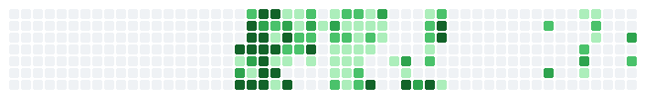

# Piyush Bhuyan

`Applied AI Engineer @ Keyloop · Hyderabad, India`

> I build production AI systems: agent orchestrators, RAG platforms, and the backend and observability that keep them running.

[Portfolio](https://pibuilt.github.io/pibuilt-piyush_portfolio/) · [LinkedIn](https://www.linkedin.com/in/piyush-bhuyan) · [Email](mailto:works.piyushb@gmail.com)

## Impact

- Cut P2 recovery time by **99%**, from 53 minutes to under 90 seconds.
- Automated **10,000+ engineering hours** a year across infrastructure workflows.

## Selected work

### [Pispyre](https://github.com/pibuilt/pispyre)

Static analysis that catches hallucinated, moved, and dead Python imports before the code runs.

`Python` `AST` `PyPI` `SARIF` `GitHub Actions`

### [SupportPilot](https://github.com/pibuilt/supportpilot)

Multi-tenant AI support platform with LangGraph orchestration, retrieval, RBAC, and observability.

`Python` `FastAPI` `PostgreSQL` `pgvector` `Redis` `LangGraph`

### [Credit Risk ML](https://github.com/pibuilt/credit-risk-ml)

End-to-end credit risk pipeline with explainability, evaluation, and deployment-ready outputs.

`Python` `scikit-learn` `XGBoost` `Pandas`

## Research

**[Layered Security: Gradient Boosting Meets Naive Bayes for Intrusion Detection](https://doi.org/10.1007/978-3-032-18282-1_2)** 
CIS 2025 · Springer LNNS Vol. 1837

## Stack

**AI / LLM**: Claude, AWS Bedrock, LangGraph, LangChain, RAG, MCP 
**Backend**: Python, FastAPI, PostgreSQL, pgvector, Redis, Celery 
**Cloud / Ops**: AWS, Docker, GitHub Actions, Grafana, MLflow

## GitHub

<picture>
  <source media="(prefers-color-scheme: dark)" srcset="https://github-readme-stats.vercel.app/api?username=pibuilt&amp;show_icons=true&amp;hide_title=true&amp;include_all_commits=true&amp;count_private=true&amp;hide=issues,prs,contribs&amp;hide_rank=true&amp;hide_border=true&amp;bg_color=00000000&amp;title_color=f5f5f5&amp;text_color=f5f5f5&amp;icon_color=f5f5f5&amp;card_width=420" />
  
</picture>

*My contribution graph, playing Game of Life. Rebuilt nightly.*

